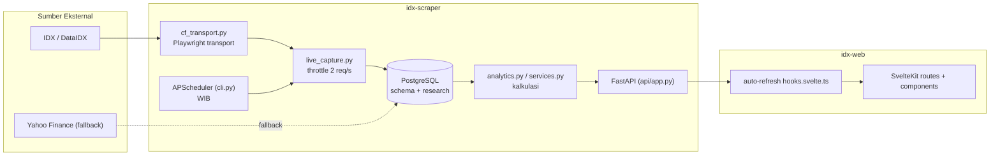
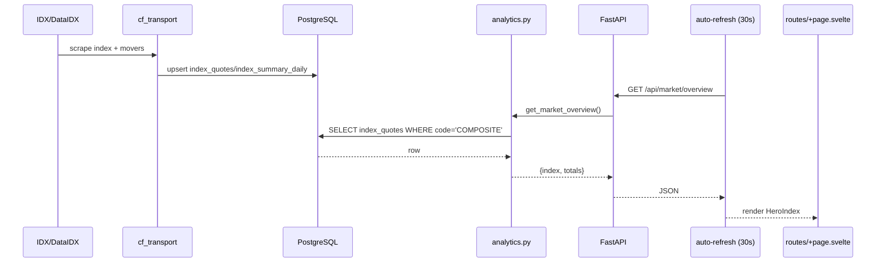
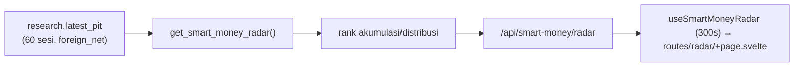
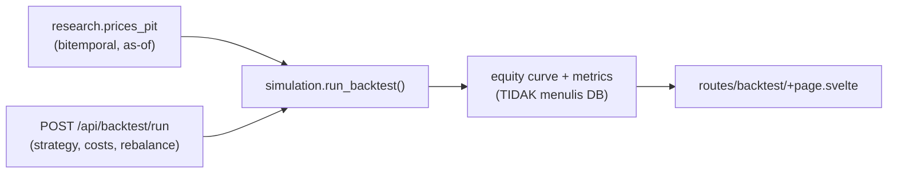
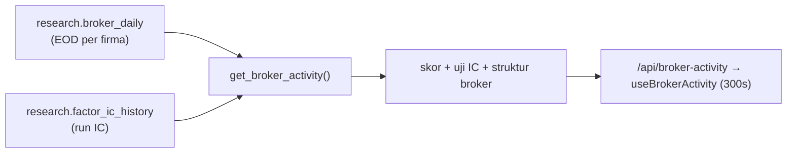
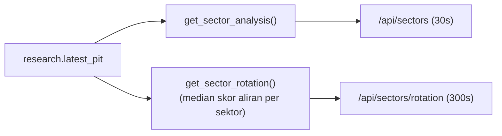
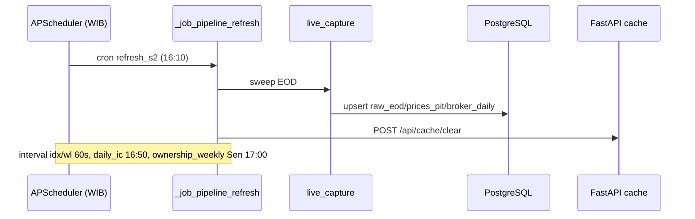

# Market Labs — Dokumentasi Menu

Dokumentasi teknis-fungsional per menu untuk aplikasi **Market Labs** (platform data pasar saham IDX). Sumber kebenaran daftar menu adalah [`lib/nav.ts`](../web/src/lib/nav.ts) (`NAV_GROUPS`, baris 22–58) yang dirender [`components/Sidebar.svelte`](../web/src/lib/components/Sidebar.svelte).

Dokumen ini dipakai oleh tiga audiens:

- **Developer baru** — onboarding: peta route, endpoint, tabel, dan job.
- **Analis / PM** — memahami fungsi tiap card dan dari mana angkanya.
- **Maintainer** — tahu kapan data dibuat, job mana yang mengisi, dan bagaimana memperbaruinya.

## Arsitektur Ringkas

- **`idx-web`** — Frontend SvelteKit 3 + `adapter-static` + Tailwind 4 (SSR mati, fallback SPA `index.html`). **Presentation-only**: nol kalkulasi bisnis. Semua data di-fetch sebagai JSON lewat auto-refresh ([`hooks.svelte.ts`](../web/src/lib/hooks.svelte.ts), interval default 30 detik). Tipe mirror di [`lib/types.ts`](../web/src/lib/types.ts), fetch client di [`lib/api.ts`](../web/src/lib/api.ts).
- **`idx-scraper`** — Backend Python/FastAPI + PostgreSQL + APScheduler (timezone WIB). Sumber kalkulasi & penyimpanan. API di [`src/idx_scraper/api/`](../../idx-scraper/src/idx_scraper/api/), scheduler di [`cli.py`](../../idx-scraper/src/idx_scraper/cli.py).
- Base URL backend: `PUBLIC_API_BASE_URL` (di-inline saat `npm run build`; default `http://localhost:8000`).
- **Chrome global** (dipasang di semua halaman): sidebar bisa diciutkan menjadi rail, tema terang/gelap, badge kesegaran data, dan command palette (Ctrl/Cmd+K). Rincian di bagian [Chrome Global](#chrome-global).



## Indeks Menu

| Group | Route | Menu | Fungsi (1 baris) | Card | Sumber data utama | Update |
|---|---|---|---|---|---|---|
| Utama | `/` | Dashboard | Ringkasan pasar: IHSG, regime, berita terbaru, leaderboard, sinyal | 9 | `index_quotes`, `index_summary_daily`, `research.latest_pit`, `research.raw_eod` | on-demand + auto-refresh 30s (kesehatan data & kesegaran 60s) |
| Utama | `/pantau` | Pantau | Watchlist + alert + chart | 5 | `watchlist`, `stock_quotes` | on-demand + auto-refresh 30s |
| Screening | `/screener` | Screener | Filter saham multi-kriteria | 3 | `research.latest_pit` | on-demand + auto-refresh 30s |
| Analisis | `/rekomendasi` | Rekomendasi Beli | Papan kandidat + badge kesegaran + track record | 3 | `research.recommendation_log` | job harian `idx recommend` |
| Analisis | `/keputusan` | Ruang Keputusan | Daftar emiten + verdict, masuk ke workspace per emiten | 5 | `research.latest_pit`, `signal_log` | on-demand (cache 1h) |
| Analisis | `/jejak-sinyal` | Jejak Sinyal | Track record sinyal vs pasar | 4 | `research.signal_log` | job `idx signal-log` |
| Analisis | `/backtest` | Backtest | Simulasi point-in-time | 8 | `research.prices_pit` | on-demand (POST, tanpa tulis DB) |
| Analisis | `/faktor` | Faktor & Kalibrasi | Bobot IC, regime, registry faktor | 6 | `research.factor_ic_history`, `regime_daily` | job `idx ic` (harian 16:50) |
| Flow | `/radar` | Radar Smart Money | Akumulasi/distribusi asing | 6 | `research.latest_pit` | on-demand + auto-refresh 300s |
| Flow | `/foreign` | Foreign Flow | Arus asing harian + top | 2 | `research.latest_pit` | on-demand + auto-refresh 30s |
| Flow | `/flow` | Aliran Dana Emiten | Timeline aliran per emiten | 4 | `research.broker_daily` | on-demand + auto-refresh 300s |
| Flow | `/sentimen` | Sentimen | Skor posisi dari jejak transaksi | 3 | `research.latest_pit` + `orderbook` | on-demand (cache 1h) |
| Flow | `/broker-activity` | Aktivitas Broker | Skor aliran + uji IC + struktur broker | 4 | `research.broker_daily`, `factor_ic_history` | on-demand + auto-refresh 300s |
| Sektor | `/sectors` | Sektor | Rotasi sektor + peta kekuatan | 3 | `research.latest_pit` | on-demand + auto-refresh 30s |

### Halaman Detail & Tambahan

| route | Tipe | Isi |
|---|---|---|
| `/stock/[code]` | Dinamis | Semua card analitik satu emiten (SmartMoneyBanner, chart, signals, ownership, foreign flow, event study, history) |
| `/keputusan/[code]` | Dinamis | Workspace keputusan per emiten (verdict, jejak asing, level pembatalan, base rate) |
| `/flow/[code]` | Dinamis | Workspace aliran dana per emiten (ForeignFlowCard, FlowTimelineCard) |
| `/radar/[code]` | Dinamis | SmartMoneyBanner + track record + back-link |
| `/dossier/[code]` | Dinamis | Dossier analisis per emiten: 7 bagian dengan tanggal sesi + export PDF ([dossier.md](./dossier.md)) |
| (semua) `error` | Status | [`routes/+error.svelte`](../web/src/routes/+error.svelte): satu komponen untuk galat dan 404 (`page.status === 404`), dengan tombol kembali dan `ThemeToggle` |
| (semua) `loading` | Status | Tidak ada berkas rute: setiap kartu merender [`components/Skeleton.svelte`](../web/src/lib/components/Skeleton.svelte) selama query-nya belum selesai |

> Route `/watchlist` tidak terdaftar di `lib/nav.ts` — watchlist diakses via menu **Pantau**. Tidak ada rute `/ruang-keputusan`; Ruang Keputusan adalah `/keputusan` (daftar) dan `/keputusan/[code]` (workspace).

### Chrome Global

Komponen yang tampil di semua halaman, tidak termasuk dalam tabel menu di atas. Perilaku di bawah ini dikonfirmasi pada UI yang saat itu berjalan di :3000 (2026-10-11); port sekarang: :3100 untuk dev, :3000 untuk sajian statis.

| Fitur | Implementasi | Perilaku | Penyimpanan lokal |
|---|---|---|---|
| Sidebar rail | [`components/Sidebar.svelte`](../web/src/lib/components/Sidebar.svelte) (`SIDEBAR_KEY`, baris 6) | Sidebar bisa diciutkan menjadi rail ikon. Grup: Utama, Screening, Analisis, Flow, Sektor | `ml-sidebar-collapsed` (`1` = ciut) |
| Tema terang/gelap | [`components/ThemeToggle.svelte`](../web/src/lib/components/ThemeToggle.svelte) (`KEY`, baris 7) | Default gelap. Skrip inline di [`src/app.html`](../web/src/app.html) (baris 12) menerapkan kelas sebelum render agar tidak ada kilatan (anti-FOUC) | `ml-theme` (`dark` / `light`) |
| Badge kesegaran data | [`components/GlobalLastUpdated.svelte`](../web/src/lib/components/GlobalLastUpdated.svelte), dirender di [`components/Topbar.svelte`](../web/src/lib/components/Topbar.svelte) baris 15 (bukan di Sidebar) | Menampilkan waktu data terakhir dari `useMarketOverview()` ([`hooks.svelte.ts`](../web/src/lib/hooks.svelte.ts), baris 91) memakai komponen `LastUpdated`. Teks awal: "Memuat data." | — |
| Command palette | [`components/CommandPalette.svelte`](../web/src/lib/components/CommandPalette.svelte), dipasang di [`routes/+layout.svelte`](../web/src/routes/+layout.svelte) baris 28 | Buka dengan Ctrl/Cmd+K, tutup dengan Esc. Berisi daftar menu (dengan kata kunci) dan pencarian emiten lewat `searchStocks()` → `GET /api/search` | — |

Sinkronisasi filter Screener: filter di [`routes/screener/+page.svelte`](../web/src/routes/screener/+page.svelte) dibaca dari `page.url.searchParams` (baris 276) dan ditulis lewat `goto()` (baris 317), sehingga tautan hasil filter bisa dibagikan dan dibuka ulang.

Logo emiten dan broker: [`components/TickerLogo.svelte`](../web/src/lib/components/TickerLogo.svelte) membaca `manifest.json` dari folder yang ditunjuk prop `basePath`, lalu memakai file lokal di folder tersebut. Bila file tidak ada, ditampilkan monogram kode.

- Emiten: `basePath="/logos"` (default), file `static/logos/{CODE}.png`, manifest [`static/logos/manifest.json`](../web/static/logos/manifest.json). Dataset: 912 logo, 51 monogram (dari 963 kode). Sumber TradingView. Dipakai di Top Leaders, Market Overview, Watchlist, Radar, Screener, Foreign Flow, Smart Money (Watchlist `/pantau` dan Pola Terkuat `/radar`), Trading Signal, Jejak Sinyal (Sinyal Terbaru), Backtest (trades dan holdings), Sentimen (Akumulasi/Distribusi), Broker Activity (Peringkat Skor Akumulasi), dan Foreign Flow peer list (`/flow/PACK`).
- Broker: `basePath="/logos/brokers"`, file `static/logos/brokers/{CODE}.jpg`, manifest [`static/logos/brokers/manifest.json`](../web/static/logos/brokers/manifest.json). Dataset: 88 logo (dari 88 kode di `research.broker_daily`), tanpa fallback. Sumber `idx.co.id/StaticData/Brokers/Logo/{CODE}.jpg`, diambil lewat `scripts/fetch_broker_logos.py` (butuh Chrome; lihat README idx-scraper). Dipakai di panel Top Broker ([`components/TopBrokersPanel.svelte`](../web/src/lib/components/TopBrokersPanel.svelte)).

Status hak cipta logo (emiten maupun broker) tetap `[BELUM TERVERIFIKASI]`. Kode broker `PC` disimpan sebagai `.bmp` (sumber mengembalikan BMP di balik URL `.jpg`) dan tetap tampil normal karena UI memakai field `file` dari manifest.

## Diagram Alur Data (Menu Kompleks)

### Dashboard


### Radar Smart Money


### Backtest


### Aktivitas Broker


### Sektor


### Sekuens Update Data


## Mapping Menu → Endpoint → Modul Backend → Tabel → Job

| Menu | Endpoint | Modul | Tabel | Job/Penjadwalan |
|---|---|---|---|---|
| Dashboard | `/api/market/overview` | `services.get_market_overview` | `index_quotes` | interval `idx` 60s |
| Dashboard | `/api/market/trade-summary` | `services.get_market_trade_summary` | `research.market_segment_daily` | EOD refresh |
| Dashboard | `/api/market/regime` | `analytics.get_market_regime` | `index_summary_daily`, `research.latest_pit` | on-demand |
| Dashboard | `/api/data-health` | `services.get_data_health` → `idx_scraper.health` | `research.prices_pit`, `index_quotes`, `research.raw_eod`, `index_summary_daily` | auto-refresh 60s |
| Dashboard | `/api/market/leaders` | `services.get_market_leaders` | `stock_summary_daily`/`stock_quotes` | interval `wl` 60s |
| Dashboard | `/api/market/top-brokers` | `services.get_top_brokers` | `research.broker_daily` | EOD refresh |
| Dashboard | `/api/signals` | `services.get_signals` | `research.latest_pit` | on-demand |
| Dashboard | `/api/stocks/{code}/technical` | `services.get_technical_chart` | `stock_daily`, `stock_quotes` | interval `wl` |
| Dashboard | `/api/news/latest` | `news.latest` | `news_items` | on-demand |
| Pantau | `/api/watchlist` (GET/POST/PUT/DELETE) | `services.get_watchlist` | `watchlist` | interval `wl` 60s |
| Pantau | `/api/alerts` (+ test) | `alerts` | alert store | interval `alerts` 300s (bila Telegram aktif) |
| Screener | `/api/screener` | `analytics.get_screener` | `research.latest_pit` | on-demand |
| Rekomendasi | `/api/recommendations` | `analytics.get_recommendations` | `research.recommendation_log` | job harian `idx recommend` |
| Rekomendasi | `/api/recommendations/track` | `analytics.get_recommendation_track` | `research.recommendation_log` | job harian |
| Rekomendasi | `/api/stocks/{code}/recommendation` | `analytics.get_stock_recommendation` | `research.recommendation_log` | on-demand |
| Ruang Keputusan | `/api/stocks/{code}/decision` | `analytics.get_stock_decision` | `research.latest_pit`, `signal_log` | on-demand (cache 1h) |
| Valuasi (endpoint backend, tanpa halaman UI) | `/api/valuation` | `analytics.get_valuation` | `research.latest_pit` | on-demand |
| Jejak Sinyal | `/api/signals/track` | `analytics.get_signal_track` | `research.signal_log` | job `idx signal-log` |
| Backtest | `/api/backtest/config` + `/run` | `simulation` | `research.prices_pit` | on-demand (POST) |
| Faktor | `/api/factors/overview` | `analytics.get_factors_overview` | `research.factor_ic_history` | job harian `daily_ic` 16:50 |
| Faktor | `/api/market/regime/history` | `analytics.get_regime_history` | `research.regime_daily` | idempoten, backfill dari `index_summary_daily` |
| Radar | `/api/smart-money/radar` | `analytics.get_smart_money_radar` | `research.latest_pit` | on-demand |
| Radar | `/api/smart-money/track-record` | `analytics.get_smart_money_track_record` | `research.latest_pit` | on-demand |
| Radar | `/api/smart-money/patterns` | `analytics.get_smart_money_patterns_board` | `research.latest_pit` | on-demand |
| Radar | `/api/smart-money/verdicts` | `analytics.get_smart_money_verdicts` | `research.latest_pit` | on-demand |
| Radar | `/api/stocks/{code}/smart-money` | `analytics.get_stock_smart_money` | `research.latest_pit` | on-demand |
| Foreign Flow | `/api/foreign-flow` | `analytics.get_foreign_flow` | `research.latest_pit` | on-demand |
| Foreign Flow | `/api/stocks/{code}/foreign-flow` | `analytics.get_stock_foreign_flow` | `research.latest_pit` | on-demand |
| Aliran Dana | `/api/broker-flow` | `analytics.get_broker_flow` | `research.broker_daily` | EOD refresh |
| Aliran Dana | `/api/stocks/{code}/broker-activity` | `analytics.get_stock_broker_activity` | `research.broker_activity` | EOD refresh |
| Sentimen | `/api/sentiment` | `analytics.get_sentiment` | `research.latest_pit`, `orderbook` | on-demand |
| Aktivitas Broker | `/api/broker-activity` | `analytics.get_broker_activity` | `research.broker_daily` | EOD refresh |
| Aktivitas Broker | `/api/stocks/{code}/brokers` | `services.get_broker_concentration` | `research.broker_daily` | EOD refresh |
| Dossier | `/api/stocks/{code}/dossier` | `dossier.build_dossier` | `research.latest_pit` + sumber analitik di atas | on-demand (sumber sudah ber-cache) |
| Dossier | `/api/stocks/{code}/dossier.pdf` | `dossier_pdf.render_dossier_pdf` | sama dengan dossier | on-demand |
| Sektor | `/api/sectors` | `analytics.get_sector_analysis` | `research.latest_pit` | on-demand |
| Sektor | `/api/sectors/rotation` | `analytics.get_sector_rotation` | `research.latest_pit` | on-demand |
| (semua) | `/api/cache/clear` | `analytics.clear_research_cache` | — | dipanggil job refresh |
| Command Palette (semua) | `/api/search?q=&limit=` | `analytics.search_stocks` ([`analytics.py`](../../idx-scraper/src/idx_scraper/api/analytics.py) baris 1626) | `research.latest_pit` | on-demand, saat mengetik di palette |
| (semua) | `/health` | — | — | — |

## Penjadwalan (APScheduler, WIB)

Sumber: [`cli.py`](../../idx-scraper/src/idx_scraper/cli.py) `cmd_serve`. Semua job refresh memanggil `POST /api/cache/clear`.

| Job ID | Jadwal | Tugas |
|---|---|---|
| `idx` | interval, `IDX_INDEX_INTERVAL` (default 60s) | refresh index |
| `wl` | interval, `IDX_WATCHLIST_INTERVAL` (default 60s) | refresh watchlist |
| `alerts` | interval, `IDX_ALERT_INTERVAL` (default 300s) | evaluasi aturan alert (bila Telegram aktif) |
| `news_refresh` | interval, `NEWS_INTERVAL` (default 900s) | tarik berita Snips 24/7 (tanpa gate jam bursa) |
| `refresh_preopen` | Mon-Fri 08:50 | pra-buka (`do_eod=False`) |
| `refresh_s1` | Mon–Thu 12:00 | sesi 1 (EOD) |
| `refresh_s1_fri` | Fri 11:30 | sesi 1 Jumat (EOD) |
| `refresh_s2` | Mon–Fri 16:10 | sesi 2 / EOD (termasuk broker summary) |
| `eod_fallback` | Mon–Fri 16:30, lalu tiap jam s/d 20:30 | jaring kedua EOD: keluar cepat kalau EOD hari ini sudah lengkap, kalau belum jalankan pipeline penuh |
| `health_eod` | Mon–Fri 17:45 | empat penjaga data (kesegaran, cakupan kolom, sesi separuh, lubang sesi) → log + Telegram; sengaja setelah `eod_fallback` dan setelah tenggat 17:30. Pemeriksa baris melewati sesi hari ini; `misfire_grace_time` 2 jam |
| `refresh_weekend_am` | Sat–Sun 08:45 | refresh akhir pekan |
| `refresh_weekend_pm` | Sat–Sun 16:00 | refresh akhir pekan |
| `daily_ic` | Mon–Fri 16:50 | hitung IC faktor → `factor_ic_history` |
| `journal_claims` | Mon–Fri 17:55–21:55 tiap jam | tulis klaim buku klaim (P6); idempoten per kode+tanggal+aturan |
| `journal_outcomes` | Mon–Fri 18:10 | isi hasil klaim yang horizonnya sudah berjalan |
| `journal_reminder` | Mon–Fri 19:20 | pengingat level tersentuh; alarm kalau sesi bisu |
| `ownership_weekly` | interval 1 minggu, mulai Sen 17:00 | snapshot ownership |

> **Startup catchup**: saat serve mulai, backend mengecek `prices_pit` dan `index_quotes`; bila kosong/stale ia memicu refresh lewat `_eod_catchup()` — fungsi yang sama dipakai job `eod_fallback` (lihat [`cli.py`](../../idx-scraper/src/idx_scraper/cli.py)).
>
> **Lubang hari bursa lampau**: `_eod_catchup()` punya dua fase — hari ini, lalu hari bursa lampau yang bolong (`_backfill_hari_lampau`, default **21** hari bursa, atur lewat `IDX_BACKFILL_DAYS`). Jadi mesin yang tidur/off melewati jendela sore tetap ditambal, tanpa menunggu `serve` di-restart (tick sore berikutnya yang melihat ke belakang). Hanya **saham** yang bisa ditarik ulang; close resmi indeks untuk tanggal lampau tidak punya sumber non-live.

## Cara Menjalankan Backend (agar semua data update)

1. **Aktifkan Postgres.** Set `IDX_STORAGE=postgres` di `.env` (jangan commit isi `.env`).
2. **Jalankan serve** (launcher + child + scheduler):
   ```powershell
   cd d:\Project\market-labs\idx-scraper
   .\scripts\start-serve.bat
   ```
   Jangan jalankan proses `score_eval` lain secara paralel tanpa alasan.
3. **Cek health**: `curl http://localhost:8000/health` → 200.
4. **Transport data live**: jalur utama **HTTP murni** (`curl_cffi`, `IDX_TRANSPORT=auto`) — tanpa kuki dan tanpa browser. Chrome hanya **cadangan**, dipakai bila IDX menolak jalur HTTP (atau `IDX_TRANSPORT=browser`); di Linux dianjurkan `IDX_TRANSPORT=http`. Bila jatuh ke Chrome, pastikan profile `IDX_CHROME_PROFILE_DIR` (mis. `p3`) tidak dipegang proses lain ("existing browser session"). Cooldown revive 600s membatasi pengulangan.
5. **Biarkan scheduler berjalan minimal satu siklus EOD** (`refresh_s2` 16:10 WIB) agar `raw_eod`/`prices_pit`/`broker_daily` terisi.
6. **Backfill manual** bila perlu: `idx eod <YYYYMMDD>`, `idx ic`, `idx signal-log`, `idx recommend`.

## Delete-Zone (Fitur UI yang Sengaja Dihapus)

Jangan dibuat ulang tanpa keputusan baru. Backend terkait tetap dipakai oleh fitur lain.

| Path / konsep | Dihapus pada | Alasan | Backend yang tetap | Syarat buat ulang |
|---|---|---|---|---|
| `app/valuation/` (app Next, diarsipkan), `docs/valuasi.md`, `useValuation` | 2026-10-11 (commit `7a08ca3`) | Fitur UI Valuasi dihapus; SvelteKit tidak punya rute ini | `GET /api/valuation` tetap (dipakai screener & Hold Check) | Keputusan baru + ADR |
| `app/hold-check/` (app Next, diarsipkan), `components/HoldCheckPanel.svelte`, `docs/hold-check.md` | 2026-10-11 (commit `4ae0dcc`) | Fitur UI Hold Check dihapus; SvelteKit tidak punya rute ini | `GET /api/hold-check` tetap (dipakai Ruang Keputusan) | Keputusan baru + ADR |

## Konvensi

- **Versi padat**: satu file per menu dengan struktur 7 bagian baku; detail identik tidak diulang antar menu.
- Rujukan `file:line` untuk endpoint, komponen, dan rumus.
- Item yang belum dapat diverifikasi dari kode ditandai `[BELUM TERVERIFIKASI]`.
- Tidak ada rahasia (kredensial/token/DSN) dalam dokumen; hanya nama variabel env.

## Daftar File

- [dashboard.md](./dashboard.md)
- [pantau.md](./pantau.md)
- [screener.md](./screener.md)
- [rekomendasi.md](./rekomendasi.md)
- [ruang-keputusan.md](./ruang-keputusan.md)
- [jejak-sinyal.md](./jejak-sinyal.md)
- [backtest.md](./backtest.md)
- [faktor.md](./faktor.md)
- [radar-smart-money.md](./radar-smart-money.md)
- [foreign-flow.md](./foreign-flow.md)
- [aliran-dana-emiten.md](./aliran-dana-emiten.md)
- [sentimen.md](./sentimen.md)
- [aktivitas-broker.md](./aktivitas-broker.md)
- [sektor.md](./sektor.md)
- [halaman-detail.md](./halaman-detail.md)
- [framework-agen.md](./framework-agen.md) — peran agen (Trading, Frontend, Trainer)
- [sumber-data.md](./sumber-data.md) — daftar sumber berita market

## Build PDF

```powershell
cd d:\Project\market-labs\idx-web\docs
& "d:\Project\market-labs\idx-scraper\.venv\Scripts\python.exe" build-pdf.py
```

Output: [`Market-Labs-Dokumentasi-Menu.pdf`](./Market-Labs-Dokumentasi-Menu.pdf)

